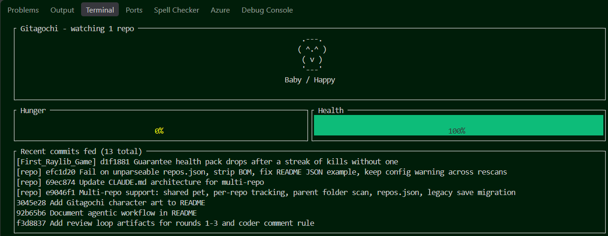

# Gitagochi

A terminal based tomagachi-like game that feeds on git commits

## Meet your Gitagochi

Your pet grows as it eats your commits: egg, then baby, then adult. Here it is in a happy mood at each stage.

```
   ___       .---.     /\___/\
  / . \     ( ^.^ )   ( ^   ^ )
 |  .  |     ( v )     (  w  )
  \___/      '---'     /|   |\
                        '---'
  Egg        Baby        Adult
```

It also gets hungry, sleepy or content depending on how recently you committed.

## About this project

This was my first experiment in AI agentic workflows, such as an orchestrator-workers setup combined with an evaluator-optimizer loop. A main Claude Code session acted as the orchestrator and wrote no code itself. It handed work to specialised subagents (coder, reviewer, adversary, gatekeeper and tester), defined in `.claude/agents/`. The agents passed state to each other through files in `docs/review/` rather than chat.

Each round worked like this:

1. The coder implements the spec (`docs/spec.md`) or fixes the items from the last verdict.
2. The reviewer reviews the diff.
3. The adversary critiques the review and the code, looking for what the reviewer missed or overstated.
4. The gatekeeper runs the build, clippy, fmt and tests, then returns `SATISFIED` or `REVISE`.
5. Once satisfied, the tester writes tests from the spec alone and flags any blocking bugs, which feed into the next round.

The loop was capped at three rounds. If it still ended in `REVISE` after the cap, the orchestrator would stop and escalate to me. The review, adversary and verdict files from each round are kept in `docs/review/`.

New work is spec-driven. `docs/constitution.md` holds the rules every feature follows. Each feature gets a folder in `docs/specs/` with a `spec.md` (requirements with IDs and acceptance criteria, which I approve), then a `plan.md` and `tasks.md` from the planner, then the loop above, with its review files in the same folder. See `docs/specs/README.md`.

## Usage

```
cargo run -- [PATH ...] [--author EMAIL]
```

Each PATH is a git repo or a parent folder holding repos. A parent folder is scanned up to 3 levels deep (it stops at a repo, skips hidden folders, `node_modules`, `target`, `venv`, `.venv` and `__pycache__`, and does not follow symlinks) and is re-scanned about once a minute, so new repos are picked up. With no PATH, the repos come from `repos.json` in the data dir (`%APPDATA%\gitagochi` on Windows), and with neither the current directory is used:

```
{"repos": ["C:\\Users\\me\\Tech & Coding", "C:\\Users\\me\\Game Development"], "author": "you@example.com"}
```

In JSON, Windows backslashes must be doubled (or use forward slashes). If `repos.json` cannot be parsed and no PATH is given, the app exits with an error naming the file and the line and column.
PATHs on the command line override the config's `repos`, and `--author` overrides its `author` (default: `git config user.email` of the first repo that has one).

All watched repos feed one shared pet, saved in `pet.json` in the data dir. A repo seen for the first time only records its current HEAD, so existing history does not feed the pet. Missing or non-repo paths show a one-line warning and the rest keep feeding; it is an error only if no repo can be found. An old single-repo save is adopted as the shared pet on first run.

Keys: `q`, `Esc` or `Ctrl-C` quits, `r` refreshes (and re-scans), and `l` opens the Rust academy.

## Rust academy

Press `l` on the pet screen for a built-in, offline Rust course for programmers who know another language and git. Its ten modules (cargo and tooling, types and control flow, ownership, structs and enums, error handling, collections and iterators, traits and generics, modules and testing, lifetimes, idiomatic Rust) each have objectives, a lesson, a project step and an assessment. The steps together build `tracker`, a command-line commit tracker that ends with a tiny pet of your own.

- Learn-screen keys: Up/Down select or scroll, Enter opens, Esc goes back (from the module list to the pet screen), `p` sets up the project, `1`-`4` or `a`-`d` answer a quiz item, `r` retakes a quiz or reruns a check, `q` quits (except while typing a path), and Ctrl-C always quits. The pet keeps living while the learn screen is open.
- Project setup (`p`): type a new or empty folder. The app writes a starter cargo project there, runs `git init`, and watches it on every run (on top of the PATHs or `repos.json`), so your commits there feed the pet. A non-empty folder is refused and left unchanged.
- A module is passed when its quiz scores 80% or more and its project check passes. The check grades your last commit (not uncommitted edits) with hidden tests plus `cargo fmt --check` and `cargo clippy -D warnings`, and includes every earlier module's checks. Failures name the check, show the compiler, test or lint message, and point to the lesson section to revisit. Later modules stay locked until the one before is passed. Passed modules show as badges on the pet screen and can be reread and retaken for practice.
- Grading needs the Rust toolchain on PATH: cargo, rustfmt and clippy from https://rustup.rs, Rust 1.85 or newer for edition 2024. Lessons and quizzes work without it.
- Progress (passed modules, best quiz scores, project folder) is saved in `progress.json` in the data dir; a corrupt file is moved to `progress.json.bak`. Grading build output is kept in `academy/` in the data dir. Set the environment variable `GITAGOCHI_DATA_DIR` to a non-empty path to use that folder as the data dir instead of the platform default (for tests and portable use).


